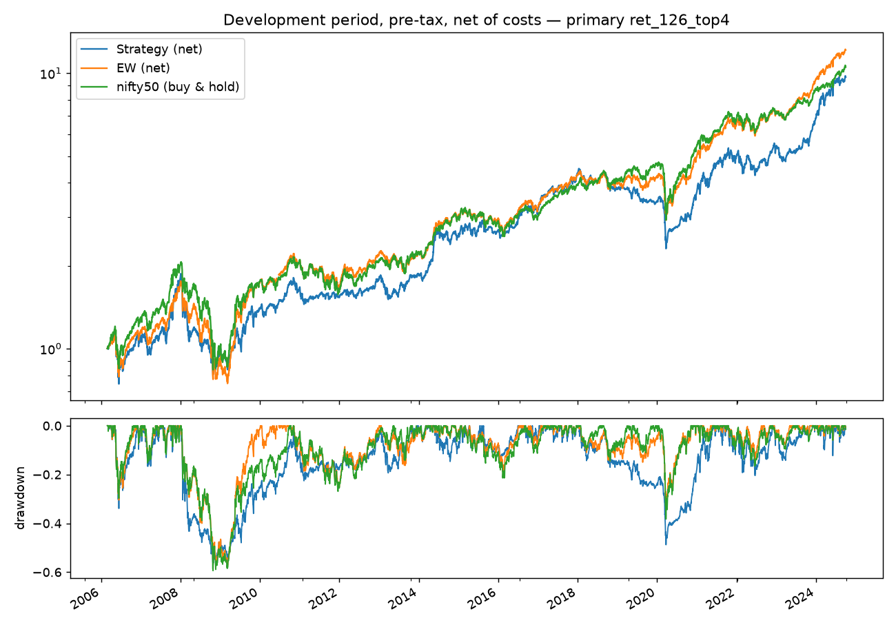
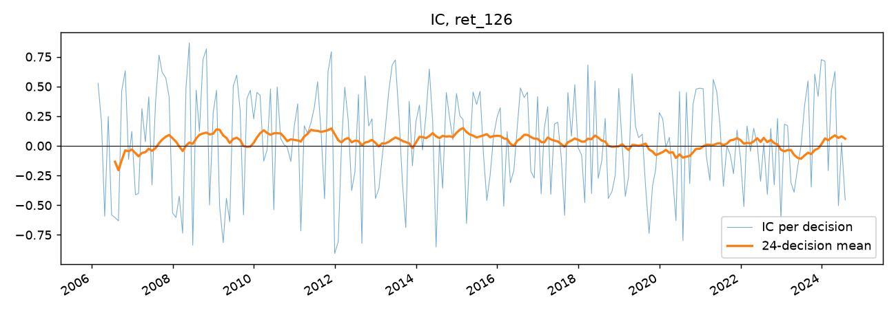
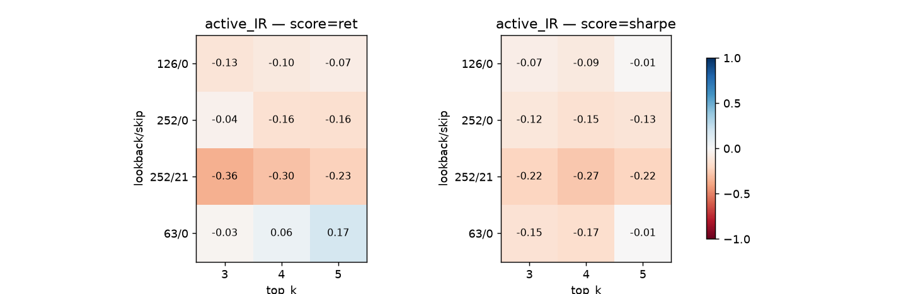
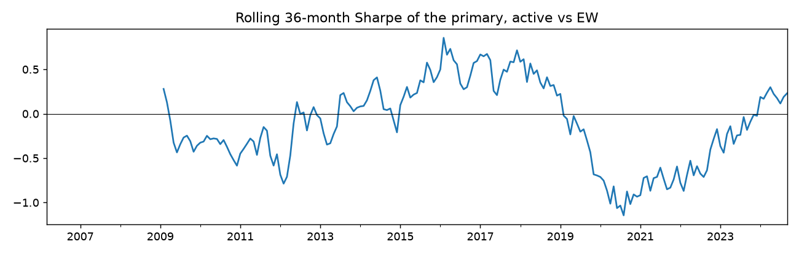

# Development-period report

Strategy: **india_etf_momentum** (model `xsec_momentum`, gates `relative_return`). Primary spec: **ret_126_top4**. Period: 2006-02-28 to 2024-09-30 (223 months). Holdout (from 2024-10-01) not touched.

## Gates (pre-registered in HYPOTHESIS.md)

| Gate | Result | Evidence |
|---|---|---|
| Data | PASS | see data_validation.md |
| Signal | FAIL | IC 0.0399, NW t 1.43, halves 0.0568 / 0.0229 |
| Strategy | FAIL | CAGR 13.0% vs EW 14.4%; Sharpe 0.41; MaxDD -57.0% vs EW -57.5% |
| Selection | FAIL | DSR 0.080 (need > 0.95); PBO 0.51 (need < 0.50) |
| Costs | FAIL | safety margin 0.0x (need >= 2.5x); active at 3x costs -2.43% |
| Tax | FAIL | after-tax CAGR 10.5% vs EW 13.3% |

**Kill criterion triggered: YES — strategy rejected**

## Performance (development period)

Sharpe and Sortino are on returns in excess of the cash asset (6% p.a. before it has history). After-tax CAGR includes tax paid each April and tax on liquidating the book on the last day.

|                         | CAGR   | Vol   |   Sharpe |   Sortino | MaxDD   |   Calmar |   MaxDD_days | VaR95_d   | CVaR95_d   | Win_m   |   ProfitFactor_m | CAGR_after_tax   |
|:------------------------|:-------|:------|---------:|----------:|:--------|---------:|-------------:|:----------|:-----------|:--------|-----------------:|:-----------------|
| Primary (net)           | 13.0%  | 20.1% |     0.41 |      0.48 | -57.0%  |     0.23 |         2177 | -1.9%     | -3.2%      | 58.7%   |             1.75 | n/a              |
| EW (net)                | 14.4%  | 18.1% |     0.5  |      0.61 | -57.5%  |     0.25 |          732 | -1.7%     | -2.8%      | 62.3%   |             1.87 | n/a              |
| Primary (after tax)     | 10.9%  | 20.4% |     0.31 |      0.35 | -59.1%  |     0.18 |         2299 | -1.9%     | -3.3%      | 57.4%   |             1.62 | 10.5%            |
| EW (after tax)          | 13.8%  | 18.1% |     0.47 |      0.58 | -57.5%  |     0.24 |          732 | -1.7%     | -2.8%      | 61.4%   |             1.84 | 13.3%            |
| nifty50 B&H (after tax) | 13.5%  | 21.5% |     0.42 |      0.54 | -59.4%  |     0.23 |          997 | -2.0%     | -3.2%      | 61.0%   |             1.77 | 12.7%            |

Reference momentum30 (price series, no costs/tax): CAGR 18.6% over the same window.

## Signal research (development period)

Monthly cross-sectional rank IC: Spearman correlation between the score at the decision close and the return from the next execution close to the following one. `IC_hm` is the mean IC against the h-month forward return (decay). `t_NW` uses Newey-West errors (3 lags).

| signal        |   mean_IC |   IC_IR |   t_NW |   1st_half |   2nd_half |   hit_rate |   n |   IC_1m |   IC_3m |   IC_6m |   IC_12m |
|:--------------|----------:|--------:|-------:|-----------:|-----------:|-----------:|----:|--------:|--------:|--------:|---------:|
| ret_126       |    0.0399 |  0.0944 | 1.4259 |     0.0568 |     0.0229 |     0.5721 | 222 |  0.0399 |  0.049  |  0.1072 |   0.0262 |
| ret_252       |    0.0478 |  0.114  | 1.72   |     0.0566 |     0.039  |     0.5811 | 222 |  0.0478 |  0.031  |  0.0483 |  -0.0308 |
| ret_252-21    |    0.0239 |  0.0566 | 0.8309 |     0.0275 |     0.0204 |     0.5495 | 222 |  0.0239 |  0.0215 |  0.0261 |  -0.0484 |
| ret_63        |    0.0534 |  0.1253 | 1.878  |     0.0622 |     0.0446 |     0.5631 | 222 |  0.0534 |  0.0238 |  0.077  |   0.0484 |
| sharpe_126    |    0.0372 |  0.1006 | 1.5876 |     0.0706 |     0.0038 |     0.5676 | 222 |  0.0372 |  0.0404 |  0.0891 |   0.015  |
| sharpe_252    |    0.0387 |  0.0995 | 1.4196 |     0.0738 |     0.0036 |     0.536  | 222 |  0.0387 |  0.0249 |  0.0401 |  -0.0402 |
| sharpe_252-21 |    0.0234 |  0.0611 | 0.8555 |     0.0552 |    -0.0084 |     0.545  | 222 |  0.0234 |  0.0097 |  0.0194 |  -0.0574 |
| sharpe_63     |    0.0376 |  0.1025 | 1.7129 |     0.0707 |     0.0046 |     0.536  | 222 |  0.0376 |  0.0053 |  0.0577 |   0.0319 |

## All 24 trials (net of costs; active = vs EW; sel_SR = annualised Sharpe of the active vs EW series)

| trial              | primary   | CAGR_net   |   Sharpe_net | MaxDD   |   Calmar | CAGR_after_tax   | MaxDD_after_tax   | active_ann   |   active_IR |   sel_SR |   turnover_pa | passes_strategy_rule   |
|:-------------------|:----------|:-----------|-------------:|:--------|---------:|:-----------------|:------------------|:-------------|------------:|---------:|--------------:|:-----------------------|
| ret_63_top3        | False     | 13.6%      |         0.42 | -54.6%  |     0.25 | 10.6%            | -56.7%            | -0.4%        |       -0.03 |    -0.03 |          5.41 | False                  |
| ret_63_top4        | False     | 14.8%      |         0.48 | -56.5%  |     0.26 | 11.8%            | -58.9%            | 0.7%         |        0.06 |     0.06 |          4.99 | False                  |
| ret_63_top5        | False     | 16.2%      |         0.55 | -55.1%  |     0.29 | 12.9%            | -57.4%            | 1.7%         |        0.17 |     0.17 |          4.48 | True                   |
| ret_126_top3       | False     | 12.2%      |         0.37 | -55.4%  |     0.22 | 9.8%             | -57.2%            | -1.7%        |       -0.13 |    -0.13 |          3.78 | False                  |
| ret_126_top4       | True      | 13.0%      |         0.41 | -57.0%  |     0.23 | 10.5%            | -59.1%            | -1.1%        |       -0.1  |    -0.1  |          3.38 | False                  |
| ret_126_top5       | False     | 13.6%      |         0.45 | -56.0%  |     0.24 | 11.1%            | -58.2%            | -0.7%        |       -0.07 |    -0.07 |          3.06 | False                  |
| ret_252_top3       | False     | 13.8%      |         0.45 | -60.9%  |     0.23 | 11.8%            | -64.0%            | -0.6%        |       -0.04 |    -0.04 |          2.81 | False                  |
| ret_252_top4       | False     | 12.5%      |         0.39 | -60.3%  |     0.21 | 10.7%            | -62.9%            | -1.8%        |       -0.16 |    -0.16 |          2.84 | False                  |
| ret_252_top5       | False     | 12.8%      |         0.41 | -61.4%  |     0.21 | 11.1%            | -63.5%            | -1.6%        |       -0.16 |    -0.16 |          2.51 | False                  |
| ret_252-21_top3    | False     | 8.8%       |         0.22 | -68.7%  |     0.13 | 7.4%             | -70.7%            | -4.7%        |       -0.36 |    -0.36 |          2.99 | False                  |
| ret_252-21_top4    | False     | 10.4%      |         0.3  | -66.2%  |     0.16 | 8.9%             | -68.0%            | -3.3%        |       -0.3  |    -0.3  |          2.85 | False                  |
| ret_252-21_top5    | False     | 11.7%      |         0.37 | -62.7%  |     0.19 | 10.1%            | -65.5%            | -2.3%        |       -0.23 |    -0.23 |          2.51 | False                  |
| sharpe_63_top3     | False     | 13.1%      |         0.48 | -48.3%  |     0.27 | 10.2%            | -50.9%            | -1.8%        |       -0.15 |    -0.15 |          4.41 | False                  |
| sharpe_63_top4     | False     | 13.0%      |         0.46 | -53.5%  |     0.24 | 10.1%            | -56.2%            | -1.8%        |       -0.17 |    -0.17 |          4.38 | False                  |
| sharpe_63_top5     | False     | 14.8%      |         0.55 | -52.6%  |     0.28 | 11.7%            | -54.9%            | -0.1%        |       -0.01 |    -0.01 |          4.24 | True                   |
| sharpe_126_top3    | False     | 14.2%      |         0.54 | -50.8%  |     0.28 | 11.2%            | -54.0%            | -1.0%        |       -0.07 |    -0.07 |          2.9  | False                  |
| sharpe_126_top4    | False     | 14.1%      |         0.54 | -55.0%  |     0.26 | 11.2%            | -58.0%            | -1.0%        |       -0.09 |    -0.09 |          2.76 | False                  |
| sharpe_126_top5    | False     | 15.0%      |         0.58 | -54.4%  |     0.28 | 11.9%            | -56.9%            | -0.1%        |       -0.01 |    -0.01 |          2.7  | True                   |
| sharpe_252_top3    | False     | 13.5%      |         0.52 | -51.6%  |     0.26 | 10.6%            | -54.9%            | -1.6%        |       -0.12 |    -0.12 |          2.49 | False                  |
| sharpe_252_top4    | False     | 13.1%      |         0.49 | -54.4%  |     0.24 | 10.8%            | -57.5%            | -1.8%        |       -0.15 |    -0.15 |          2.18 | False                  |
| sharpe_252_top5    | False     | 13.6%      |         0.49 | -57.5%  |     0.24 | 11.5%            | -60.2%            | -1.3%        |       -0.13 |    -0.13 |          2.09 | False                  |
| sharpe_252-21_top3 | False     | 11.8%      |         0.42 | -56.8%  |     0.21 | 9.3%             | -59.6%            | -3.1%        |       -0.22 |    -0.22 |          2.63 | False                  |
| sharpe_252-21_top4 | False     | 11.6%      |         0.4  | -56.8%  |     0.2  | 9.7%             | -58.9%            | -3.2%        |       -0.27 |    -0.27 |          2.26 | False                  |
| sharpe_252-21_top5 | False     | 12.5%      |         0.44 | -57.1%  |     0.22 | 10.6%            | -58.7%            | -2.2%        |       -0.22 |    -0.22 |          1.95 | False                  |

Robustness: 8% of the grid has positive active IR (sensitivity-analysis skill targets > 60%).

## Selection statistics (active vs EW, monthly)

- Deflated Sharpe Ratio of the primary, N = 24: **0.080** (per-month SR -0.028 vs expected max under null 0.066; skew -0.46, kurtosis 5.84; n = 223).
- PSR (ignoring selection): 0.340; block-bootstrap one-sided p-value for mean > 0: 0.650.
- DSR of the best grid cell: 0.402.
- Sharpe haircut on the best annualised Sharpe (0.17): -0.06.
- PBO (CSCV, 16 blocks, 12870 splits): **0.51**; in-sample-best per-month SR 0.076 -> out-of-sample -0.031.
- Paired block bootstrap, Sharpe(primary) > Sharpe(EW) on excess-over-cash returns: one-sided p = 0.647.

## Walk-forward selection (trial 25)

Each January, pick the grid cell with the best trailing Sharpe of its active vs EW series and hold it for the year (stitched monthly returns; switching costs between cells are ignored).

| Variant | Mean p.a. | Sharpe | Primary, same window |
|---|---|---|---|
| expanding | 0.25% | 0.03 | 0.33% / 0.03 |
| rolling | -1.85% | -0.15 | 0.33% / 0.03 |

Picks (expanding): 2011: ret_63_top5, 2012: sharpe_63_top5, 2013: ret_63_top5, 2014: sharpe_63_top5, 2015: sharpe_63_top5, 2016: sharpe_63_top5, 2017: ret_63_top5, 2018: ret_63_top5, 2019: ret_63_top5, 2020: ret_63_top5, 2021: ret_63_top5, 2022: ret_63_top5, 2023: ret_63_top5, 2024: ret_63_top5

## Costs, capacity

|   cost_x | CAGR   |   Sharpe | MaxDD   | EW_CAGR   |   EW_Sharpe | active_ann   | sel_ann   | cost_drag_pa   |
|---------:|:-------|---------:|:--------|:----------|------------:|:-------------|:----------|:---------------|
|        0 | 13.85% |     0.45 | -56.71% | 14.51%    |        0.51 | -0.47%       | -0.35%    | 0.00%          |
|        1 | 12.98% |     0.41 | -57.03% | 14.37%    |        0.5  | -1.13%       | -1.13%    | 0.77%          |
|        2 | 12.12% |     0.36 | -57.35% | 14.24%    |        0.49 | -1.78%       | -1.90%    | 1.53%          |
|        3 | 11.27% |     0.32 | -57.66% | 14.10%    |        0.49 | -2.43%       | -2.67%    | 2.29%          |

- Safety margin (gross active return / cost drag): **0.0x**.
- Cost split at 1x (rupees over the period): explicit 52,441, spread 311,998, impact 38,096.
- Capacity (95th-percentile trade at <= 5% of current ETF ADV): about **Rs 1.0 crore**.

## Latest development-period holdings

NEXT50 25%, PHARMA 25%, AUTO 25%, CPSE 25%

