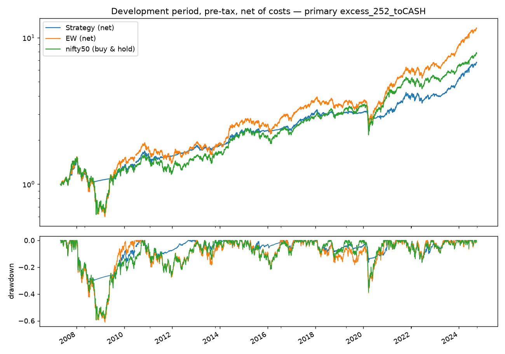
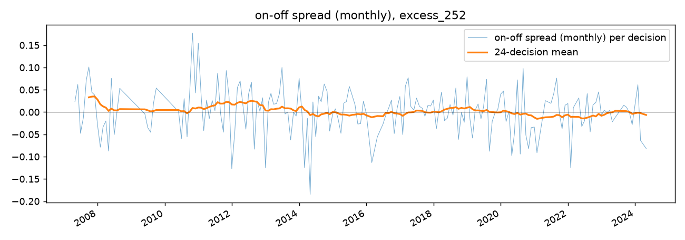
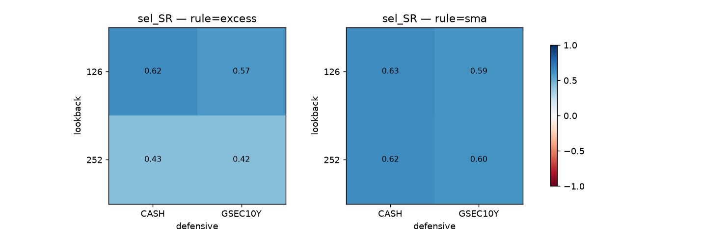
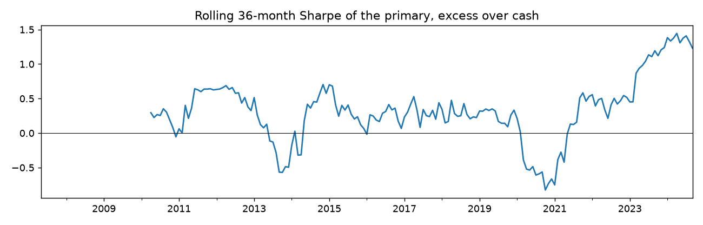

# Development-period report

Strategy: **india_etf_trend** (model `ts_trend`, gates `risk_reduction`). Primary spec: **excess_252_toCASH**. Period: 2007-04-30 to 2024-09-30 (209 months). Holdout (from 2024-10-01) not touched.

## Gates (pre-registered in HYPOTHESIS.md)

| Gate | Result | Evidence |
|---|---|---|
| Data | PASS | see data_validation.md |
| Signal | FAIL | on-off spread (monthly) 0.0015, NW t 0.37, halves 0.0068 / -0.0038 |
| Strategy | FAIL | MaxDD -31.2% vs limit -40.7% (EW -61.1%); Sharpe 0.41 vs EW 0.48; Calmar 0.37 vs EW 0.25 |
| Selection | FAIL | DSR 0.887 (need > 0.95); PBO 0.74 (need < 0.50); Sharpe-vs-EW bootstrap p 0.543 (need < 0.1) |
| Costs | FAIL | at 3x costs Sharpe 0.37 vs EW 0.46; cost drag 0.22% a year |
| Tax | FAIL | after-tax CAGR 10.2% vs EW 14.1% (tolerance 2.0 pp); after-tax MaxDD -31.8% vs limit -41.1% |

**Kill criterion triggered: YES — strategy rejected**

## Performance (development period)

Sharpe and Sortino are on returns in excess of the cash asset (6% p.a. before it has history). After-tax CAGR includes tax paid each April and tax on liquidating the book on the last day.

|                         | CAGR   | Vol   |   Sharpe |   Sortino | MaxDD   |   Calmar |   MaxDD_days | VaR95_d   | CVaR95_d   | Win_m   |   ProfitFactor_m | CAGR_after_tax   |
|:------------------------|:-------|:------|---------:|----------:|:--------|---------:|-------------:|:----------|:-----------|:--------|-----------------:|:-----------------|
| Primary (net)           | 11.6%  | 11.8% |     0.41 |      0.46 | -31.2%  |     0.37 |          953 | -1.1%     | -1.9%      | 73.2%   |             2.35 | n/a              |
| EW (net)                | 15.1%  | 19.5% |     0.48 |      0.59 | -61.1%  |     0.25 |          902 | -1.8%     | -3.0%      | 60.8%   |             1.84 | n/a              |
| Primary (after tax)     | 10.5%  | 11.8% |     0.33 |      0.36 | -31.8%  |     0.33 |          973 | -1.2%     | -1.9%      | 70.3%   |             2.19 | 10.2%            |
| EW (after tax)          | 14.6%  | 19.5% |     0.45 |      0.56 | -61.6%  |     0.24 |          902 | -1.8%     | -3.0%      | 60.8%   |             1.81 | 14.1%            |
| nifty50 B&H (after tax) | 12.5%  | 21.1% |     0.35 |      0.45 | -59.4%  |     0.21 |          997 | -1.9%     | -3.1%      | 59.3%   |             1.73 | 11.7%            |

## Signal research (development period)

Time-series test: at each decision, the mean forward excess-over-cash return of assets whose signal is on minus those whose signal is off (execution close to next execution close). `spread_hm` uses h-month forward returns; `IC_xs` is the cross-sectional rank IC, for reference. `t_NW` uses Newey-West errors (3 lags).

| signal     |   mean_spread_m |   on_excess_m |   off_excess_m |   t_NW |   1st_half |   2nd_half |   share_on |   IC_xs |   n |   spread_1m |   spread_3m |   spread_6m |   spread_12m |
|:-----------|----------------:|--------------:|---------------:|-------:|-----------:|-----------:|-----------:|--------:|----:|------------:|------------:|------------:|-------------:|
| excess_126 |          0.0037 |        0.0073 |         0.0036 | 0.9382 |     0.0118 |    -0.0043 |     0.575  |  0.0436 | 184 |      0.0037 |      0.0144 |      0.0372 |       0.0115 |
| excess_252 |          0.0015 |        0.0063 |         0.0052 | 0.3713 |     0.0068 |    -0.0038 |     0.5966 |  0.0518 | 179 |      0.0015 |      0.0056 |      0.0129 |      -0.0022 |
| sma_126    |          0.0039 |        0.0065 |         0.0009 | 0.9995 |     0.0045 |     0.0032 |     0.6451 |  0.0318 | 178 |      0.0039 |      0.0078 |      0.0345 |       0.0183 |
| sma_252    |          0.0005 |        0.0079 |         0.0037 | 0.1281 |     0.0009 |     0.0002 |     0.6877 |  0.0589 | 178 |      0.0005 |      0.0116 |      0.0329 |       0.0185 |

## All 8 trials (net of costs; active = vs EW; sel_SR = annualised Sharpe of the excess over cash series)

| trial                | primary   | CAGR_net   |   Sharpe_net | MaxDD   |   Calmar | CAGR_after_tax   | MaxDD_after_tax   | active_ann   |   active_IR |   sel_SR |   turnover_pa | passes_strategy_rule   |
|:---------------------|:----------|:-----------|-------------:|:--------|---------:|:-----------------|:------------------|:-------------|------------:|---------:|--------------:|:-----------------------|
| excess_126_toCASH    | False     | 14.6%      |         0.63 | -29.7%  |     0.49 | 12.6%            | -29.7%            | -2.1%        |       -0.14 |     0.62 |          1.67 | True                   |
| excess_126_toGSEC10Y | False     | 14.4%      |         0.59 | -33.6%  |     0.43 | 12.3%            | -34.6%            | -2.2%        |       -0.13 |     0.57 |          1.67 | True                   |
| excess_252_toCASH    | True      | 11.6%      |         0.41 | -31.2%  |     0.37 | 10.2%            | -31.8%            | -4.9%        |       -0.3  |     0.43 |          1.28 | False                  |
| excess_252_toGSEC10Y | False     | 11.9%      |         0.42 | -35.6%  |     0.33 | 10.3%            | -36.4%            | -4.5%        |       -0.26 |     0.42 |          1.28 | False                  |
| sma_126_toCASH       | False     | 15.8%      |         0.69 | -23.9%  |     0.66 | 13.6%            | -23.9%            | -0.9%        |       -0.07 |     0.63 |          2.06 | True                   |
| sma_126_toGSEC10Y    | False     | 15.5%      |         0.65 | -28.3%  |     0.55 | 13.3%            | -30.6%            | -1.0%        |       -0.07 |     0.59 |          2.06 | True                   |
| sma_252_toCASH       | False     | 14.6%      |         0.61 | -29.8%  |     0.49 | 12.9%            | -30.5%            | -2.1%        |       -0.14 |     0.62 |          1.34 | True                   |
| sma_252_toGSEC10Y    | False     | 14.9%      |         0.6  | -35.5%  |     0.42 | 13.0%            | -36.2%            | -1.8%        |       -0.11 |     0.6  |          1.34 | True                   |

Robustness: 75% of the grid passes the strategy-gate rule (sensitivity-analysis skill targets > 60%).

## Selection statistics (excess over cash, monthly)

- Deflated Sharpe Ratio of the primary, N = 8: **0.887** (per-month SR 0.123 vs expected max under null 0.036; skew -0.59, kurtosis 6.24; n = 209).
- PSR (ignoring selection): 0.956; block-bootstrap one-sided p-value for mean > 0: 0.047.
- DSR of the best grid cell: 0.990.
- Sharpe haircut on the best annualised Sharpe (0.63): +0.50.
- PBO (CSCV, 16 blocks, 12870 splits): **0.74**; in-sample-best per-month SR 0.201 -> out-of-sample 0.157.
- Paired block bootstrap, Sharpe(primary) > Sharpe(EW) on excess-over-cash returns: one-sided p = 0.543.

## Walk-forward selection (trial 9)

Each January, pick the grid cell with the best trailing Sharpe of its excess over cash series and hold it for the year (stitched monthly returns; switching costs between cells are ignored).

| Variant | Mean p.a. | Sharpe | Primary, same window |
|---|---|---|---|
| expanding | 5.86% | 0.54 | 5.25% / 0.58 |
| rolling | 6.04% | 0.59 | 5.25% / 0.58 |

Picks (expanding): 2012: sma_126_toCASH, 2013: sma_126_toCASH, 2014: sma_126_toCASH, 2015: sma_126_toCASH, 2016: excess_126_toCASH, 2017: sma_126_toCASH, 2018: excess_126_toCASH, 2019: excess_126_toCASH, 2020: excess_126_toCASH, 2021: sma_126_toCASH, 2022: excess_126_toCASH, 2023: sma_126_toCASH, 2024: sma_126_toCASH

## Costs, capacity

|   cost_x | CAGR   |   Sharpe | MaxDD   | EW_CAGR   |   EW_Sharpe | active_ann   | sel_ann   | cost_drag_pa   |
|---------:|:-------|---------:|:--------|:----------|------------:|:-------------|:----------|:---------------|
|        0 | 11.84% |     0.43 | -31.06% | 15.23%    |        0.48 | -4.81%       | 5.12%     | 0.00%          |
|        1 | 11.60% |     0.41 | -31.18% | 15.10%    |        0.48 | -4.92%       | 4.90%     | 0.22%          |
|        2 | 11.35% |     0.39 | -31.31% | 14.97%    |        0.47 | -5.03%       | 4.67%     | 0.45%          |
|        3 | 11.09% |     0.37 | -31.44% | 14.85%    |        0.46 | -5.15%       | 4.44%     | 0.68%          |

- Safety margin (gross excess-over-cash return / cost drag): **22.9x**.
- Cost split at 1x (rupees over the period): explicit 31,456, spread 58,282, impact 2,488.
- Capacity (95th-percentile trade at <= 5% of current ETF ADV): about **Rs 8.3 crore**.

## Latest development-period holdings

NIFTY50 6%, NEXT50 6%, MIDCAP150 6%, SMALLCAP250 6%, BANK 6%, IT 6%, PHARMA 6%, FMCG 6%, AUTO 6%, METAL 6%, OILGAS 6%, REALTY 6%, PSUBANK 6%, CPSE 6%, GOLD 6%, SILVER 6%

